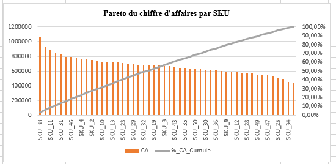
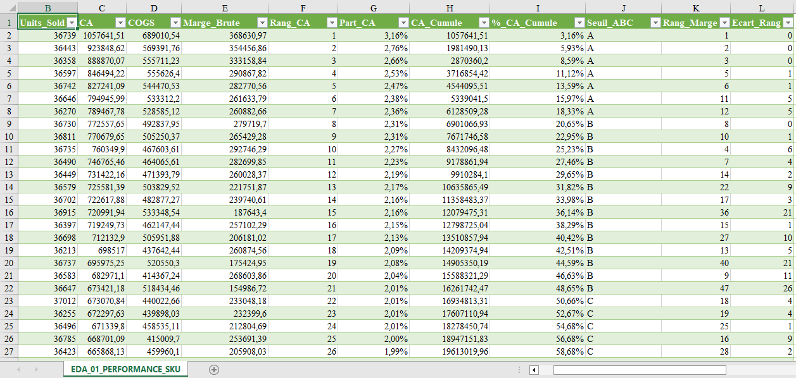

# Supply Chain Analytics with Excel

## 1. Présentation du projet

Ce projet consiste à analyser un jeu de données Supply Chain à l'aide de Microsoft Excel afin de transformer les données opérationnelles en informations utiles à la prise de décision.

Il s'inscrit dans une démarche d'apprentissage pratique du métier de Data Analyst, en mettant l'accent sur les problématiques métier, l'analyse exploratoire des données (EDA) et la communication des résultats.

## 2. Problématique métier

**Comment exploiter les données de la chaîne d'approvisionnement pour mieux comprendre la performance commerciale, maîtriser les stocks, évaluer les prévisions de demande et identifier les risques opérationnels ?**

## 3. Objectifs de l'analyse

- Analyser les ventes et la performance des produits (SKU).
- Évaluer les niveaux de stock et les risques de rupture.
- Étudier les écarts entre la demande réelle et les prévisions.
- Examiner les délais moyens des fournisseurs.
- Comparer les performances des entrepôts et des régions.
- Identifier les indicateurs utiles à la prise de décision.

## 4. Jeu de données

Le jeu de données utilisé contient **91 250 lignes** couvrant l'année 2024.

Il comprend notamment des informations sur les produits, les entrepôts, les fournisseurs, les ventes, les stocks, les délais d'approvisionnement et les prévisions de demande.

## 5. Outils utilisés

- **Microsoft Excel** : exploration des données (EDA), formules, analyses et visualisations.
- **Power Query** : importation, nettoyage, contrôle de qualité et préparation des données, ainsi que réalisation de certaines étapes de l’EDA 01 — Performance SKU.
- GitHub pour la documentation et le suivi des versions du projet

## 6. Analyses métier

| Module | Objectif | Statut |
|---|---|---|
| EDA 01 — Performance SKU | Étudier les ventes, le chiffre d'affaires et les marges | Première analyse publiée |
| EDA 02 — Inventaire | Examiner les niveaux de stock et les indicateurs d'inventaire | À réaliser |
| EDA 03 — Prévisions de demande | Étudier les écarts entre ventes réelles et prévisions | À réaliser |
| EDA 04 — Fournisseurs | Comparer les délais d'approvisionnement | À réaliser |
| EDA 05 — Entrepôts et régions | Comparer les volumes vendus selon les zones et les entrepôts | À réaliser |
| EDA 06 — Risques Supply Chain | Étudier les indicateurs de risque liés aux stocks | À réaliser |

## 7. EDA 01 — Performance commerciale des SKU

### Question métier

**Quels SKU contribuent le plus au chiffre d'affaires, et quelle est la concentration du portefeuille ?**

### Méthode

- Calcul du chiffre d'affaires, du coût des marchandises vendues et de la marge brute par SKU.
- Classement des 50 SKU selon leur chiffre d'affaires.
- Calcul de la part de chiffre d'affaires et de la part cumulée.
- Utilisation d'une analyse de Pareto pour examiner la concentration du chiffre d'affaires.
- Comparaison du classement par chiffre d'affaires avec celui par marge brute.

### Premiers enseignements

- **SKU_38, SKU_40 et SKU_11** figurent parmi les SKU les plus contributeurs au chiffre d'affaires.
- Il faut cumuler **38 SKU sur 50** pour atteindre environ **80 % du chiffre d'affaires**. Le chiffre d'affaires est donc réparti entre une part importante du portefeuille, plutôt que concentré uniquement sur quelques références.
- Le classement par chiffre d'affaires ne suffit pas à juger la rentabilité : il doit être complété par l'analyse de la marge brute.
- Le classement et le graphique de Pareto servent à prioriser les références à examiner, sans remplacer l'analyse des coûts, des marges et des contraintes opérationnelles.

### Visuels de l'analyse

#### Pareto du chiffre d'affaires par SKU

Le graphique compare le chiffre d'affaires individuel de chaque SKU (barres) à la part cumulée du chiffre d'affaires (courbe).

#### Tableau de performance des SKU

Le tableau présente notamment le chiffre d'affaires, le coût des marchandises vendues, la marge brute, le rang selon le chiffre d'affaires, la part cumulée, la classification ABC et l'écart entre les rangs de chiffre d'affaires et de marge.

**Classeur Excel :** [EDA_01_Performance_SKU.xlsx](./EDA_01_Performance_SKU.xlsx)

## 8. Démarche de travail

Le projet est réalisé progressivement. Chaque module est analysé, vérifié et documenté avant sa publication.

Les conclusions sont ajoutées au fur et à mesure de la validation des résultats. Le tableau de bord global sera développé dans une étape ultérieure.

## 9. Statut du projet

**En cours de réalisation.**

Ce portfolio évoluera progressivement avec les analyses, les visualisations et les enseignements tirés du projet.
